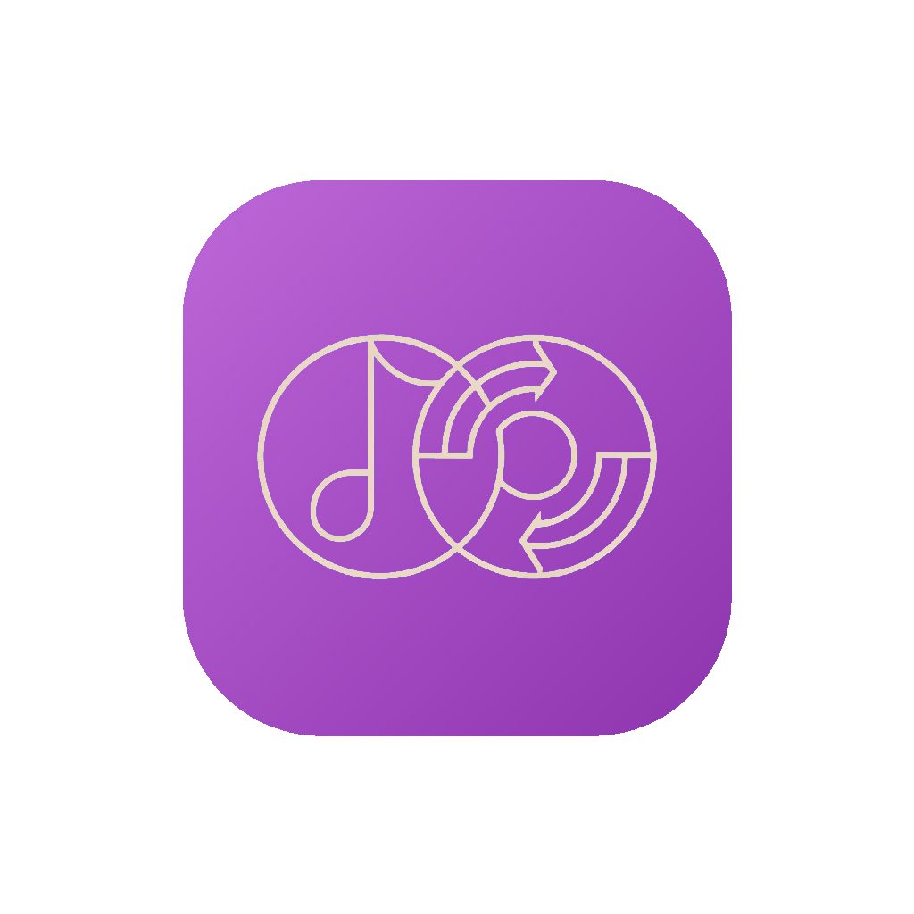

<div align="center">



# List Buddy

**Exportá y previsualizá las playlists de tu librería de DJ.**
Lee Rekordbox (por el XML que exporta) y Traktor Pro 3/4, y copia las pistas a carpetas numeradas en orden.

[](https://www.gnu.org/licenses/gpl-3.0)
[](https://ko-fi.com/gabrielmaglia)

</div>

---

## Qué hace

List Buddy lee tu librería de **Rekordbox** (6 o 7, por el XML que exporta) o **Traktor Pro 3/4**, te muestra el árbol
de carpetas y playlists, y copia las pistas que elijas a carpetas organizadas con un
prefijo numérico de orden:

```
<destino>/<nombre de playlist>/
    001 - Artist - Title.mp3
    002 - Artist - Title.aiff
    003 - Artist - Title.flac
    ...
```

Además podés **escuchar las pistas antes de exportar**, sin salir de la app.

## Características

- 🎛 **Dos fuentes** — Rekordbox (por el XML que exporta) y Traktor Pro 3/4, con un switch para cambiar entre ellas.
- 🔢 **Exportación numerada** — cada playlist va a su carpeta, con prefijo de orden y nombre `Artista - Título`.
- 🔊 **Reproductor integrado** — clickeá cualquier pista para escucharla. Soporta mp3, wav, aiff, mp4/m4a, **flac** y wma (backend FFmpeg de Qt).
- 📊 **Forma de onda** — en el reproductor de abajo; clickeala para saltar a cualquier punto.
- 🎹 **Key · BPM** — tonalidad y tempo de cada pista en la vista previa.
- ⏯ **Controles** — play/pausa desde la nota ♪ o con la **barra espaciadora**, barra de progreso con seek, y auto-avance al siguiente track.
- ⚠️ **Detección de archivos faltantes** — las pistas cuyo archivo no está en disco se marcan en rojo y no se pueden reproducir.
- 🔧 **Reparar enlaces rotos (relocate)** — si moviste tu música de carpeta o disco, List Buddy busca cada archivo faltante por nombre en la ubicación que le indiques y **repara el enlace en tu propia librería** (Traktor `collection.nml`; en Rekordbox usá Reubicar, ver abajo). Siempre hace un **backup automático** antes de escribir, y ante varios candidatos te pregunta cuál es (con un checkbox opcional para resolver todo automáticamente por mejor coincidencia).
- ⚙️ **Configuración** — selector de dispositivo de salida de audio, auto-avance y override de la ruta de la librería.
- 🌗 **Tema claro / oscuro** estilo macOS.
- ⚡ **Sin congelamientos** — las operaciones pesadas (existencia de archivos, decodificación, copia) corren en hilos separados.

## Descargar

Bajá la última versión desde [Releases](https://github.com/gabiMaglia/listBuddy-rekordbox-/releases).

- **macOS 13 o posterior.** Abrí el `.dmg` y arrastrá **List Buddy** a Aplicaciones.
- **Windows:** todavía sin ejecutable probado; podés correrlo desde el código fuente.

## Requisitos

- **Python 3.11+** (solo para correrlo desde el código fuente)
- **Rekordbox 6 o 7** (con su colección exportada a XML) y/o **Traktor Pro 3/4** instalados.
- Rekordbox puede estar abierto: List Buddy lee el XML exportado. Traktor tiene que estar **cerrado** solo al reparar enlaces.

## Instalación desde fuente

```bash
git clone https://github.com/gabiMaglia/listBuddy-rekordbox-.git
cd listBuddy-rekordbox-
python -m venv .venv
source .venv/bin/activate          # Windows: .\.venv\Scripts\activate
pip install -r requirements.txt
```

### Primera vez con Rekordbox

List Buddy lee el XML que exporta Rekordbox, no su base de datos:

1. En Rekordbox: **Archivo → Exportar colección en formato xml** y guardá el archivo.
2. En List Buddy: **⚙ Configuración → Librerías** y elegí ese `rekordbox.xml`.
3. Cuando cambies tus playlists en Rekordbox, volvé a exportar el XML.

## Ejecutar

```bash
python main.py
```

## Uso

1. Elegí la **fuente** (Rekordbox o Traktor) con el switch de la izquierda.
2. Elegí la **carpeta de destino** donde se van a crear las subcarpetas.
3. Marcá las **playlists** que querés exportar (o usá **Todas** / **Ninguna**).
4. Revisá la **vista previa** a la derecha: ahí ves cómo van a quedar numeradas las
   pistas, y cuáles faltan (en rojo).
5. Hacé click en **Exportar en orden**.

Las pistas ya existentes en el destino se saltan, así que podés re-exportar sin duplicar.

### Reparar enlaces rotos (solo Traktor)

Si moviste tu música y en la vista previa aparecen pistas **en rojo** (archivo no
encontrado), podés reparar los enlaces sin salir de List Buddy:

1. Asegurate de que **Traktor esté cerrado** (la librería se escribe, no solo se lee).
2. Hacé click en **🔧 Reparar enlaces rotos…** y elegí la carpeta o disco donde
   está ahora tu música.
3. List Buddy indexa esa ubicación y, por cada pista rota, busca el archivo por
   nombre:
   - **1 coincidencia** → la aplica.
   - **varias** → te muestra un modal para que elijas (o tildá *Resolver
     automáticamente* para que tome la mejor coincidencia sin preguntar).
   - **0** → la deja sin tocar y la lista en el log.
4. Antes de escribir, se crea un **backup** de tu librería en una subcarpeta
   `listBuddy_backups/` junto al archivo original. Si algo falla, no se escribe
   nada: tu librería queda intacta.

> La escritura es atómica y con backup previo, pero **es tu librería real**:
> revisá el resumen y tené el backup a mano por las dudas.

**En Rekordbox** usá Reubicar: Archivo → Mostrar todos los archivos que faltan →
Reubicar automáticamente, y volvé a exportar el XML. List Buddy no modifica tu librería
de Rekordbox.

### Reproducir

- Clickeá cualquier pista del panel de vista previa para escucharla.
- La nota **♪** del banner alterna play/pausa (también con la **barra espaciadora**).
- La **barra de progreso** debajo del banner permite saltar a cualquier punto.
- Al terminar una pista, suena la siguiente de la lista (configurable).

### Configuración (⚙ en el header)

- **Dispositivo de salida de audio** — elegí por qué salida suena la previsualización.
- **Auto-avance** — on/off.
- **Librerías** — elegí acá el `rekordbox.xml` exportado (Rekordbox) y, si está en una
  ubicación no estándar, el `collection.nml` (Traktor). El botón
  **Auto** vuelve a la autodetección.

## Empaquetar a ejecutable

```bash
pip install pyinstaller
pyinstaller rb_exporter.spec
```

El resultado queda en `dist/`. El `.spec` ya incluye el ícono, los hidden imports de
el motor de audio (QtMultimedia + FFmpeg, que PyInstaller recoge
automáticamente).

> **No se puede cross-compilar:** el ejecutable de macOS solo se genera desde una Mac, y el
> de Windows solo desde Windows. Para distribuir en macOS hace falta firmar el binario
> (ver la sección de empaquetado en [CLAUDE.md](CLAUDE.md)).

Para regenerar el ícono:

```bash
python scripts/make_icon.py
```

## Logs

Si algo falla, List Buddy escribe un log rotativo que podés adjuntar para diagnosticar:

| OS | Ruta |
|---|---|
| macOS | `~/Library/Logs/listBuddy/listBuddy.log` |
| Windows | `%LOCALAPPDATA%\listBuddy\logs\listBuddy.log` |
| Linux | `~/.local/state/listBuddy/listBuddy.log` |

## Tests

Cubren sobre todo las piezas que **escriben sobre tu librería** (rutas de Traktor,
matching, backup + poda, escritura atómica, sincronización COLLECTION↔PLAYLISTS) y la
interfaz Qt, que corre en procesos aislados.

```bash
pip install -r requirements-dev.txt
pytest
```


## Estructura del proyecto

```
main.py              # entry point + logging/excepthook
ui.py                # MainWindow (PySide6): layout, reproducción, exportación, settings
ui_components.py     # widgets custom (cards, seek bar, file rows, rack head)
worker.py            # ExportWorker (QThread): copia y numera los archivos
traktor_relocate.py  # RelocateWorker (QThread): repara enlaces rotos del NML de Traktor
preview_worker.py    # PreviewWorker (QThread): chequeo de existencia en background
audio_player.py      # AudioPlayer (QMediaPlayer + FFmpeg)
waveform_worker.py   # WaveformWorker (QThread): picos de la forma de onda
db.py                # utilidades compartidas (orden de playlist, Key · BPM)
rekordbox_xml.py     # lector del rekordbox.xml exportado de Rekordbox
traktor_db.py        # parser de la colección NML de Traktor
rekordbox_export.py  # lógica base validada (nombres de archivo + copia)
app_logging.py       # logging a archivo + manejo global de excepciones
about_dialog.py      # «Acerca de»: licencia, garantía y avisos de terceros
styles.py + qss/     # design system (tokens + hojas QSS dark/light)
rb_exporter.spec     # spec de PyInstaller
scripts/make_icon.py # generador del ícono
tests/               # tests de correctitud (rutas, matching, backup, sync)
```

## Tecnología

Python · PySide6 · numpy · PyInstaller

## Donaciones

List Buddy es gratuito y de código abierto. Si te sirvió, podés invitarme un café:

**[ko-fi.com/gabrielmaglia](https://ko-fi.com/gabrielmaglia)** — o escaneá el QR desde
el menú **Ayuda → Donar en Ko-fi…** dentro de la app.

## Licencia

GNU General Public License v3.0 o posterior — ver [LICENSE](LICENSE).

En resumen: podés usar, modificar y redistribuir este software libremente, siempre que
cualquier versión redistribuida también sea de código abierto bajo GPL v3.

Los componentes de terceros que viajan en el ejecutable (Qt/PySide6, FFmpeg, numpy y otros) tienen sus propias licencias: ver
[THIRD_PARTY_NOTICES.md](THIRD_PARTY_NOTICES.md) y la carpeta [licenses/](licenses/).
También están en la app, en **Ayuda → Acerca de List Buddy**.

## Avisos

- **Sin garantía.** List Buddy se ofrece tal cual. La reparación de enlaces de Traktor
  escribe sobre tu librería real: siempre hace backup, pero tené tu propia copia.
- **Compatibilidad.** Lee el XML de Rekordbox (formato publicado por AlphaTheta) y el NML
  de Traktor (no documentado por su fabricante); una actualización de esos programas puede romperlo sin aviso.
- **Tu música.** List Buddy solo copia archivos que ya están en tu disco. Sos responsable
  de tener los derechos sobre lo que copiás.
- **Privacidad.** No recolecta datos. La única conexión a internet es al arrancar, para
  consultar en GitHub si hay una versión nueva.

---

<sub>Rekordbox es una marca de AlphaTheta / Pioneer DJ. Traktor es una marca de Native
Instruments. List Buddy es un proyecto independiente, sin afiliación ni respaldo de esas
empresas; lee sus librerías localmente para tu propio uso.</sub>
